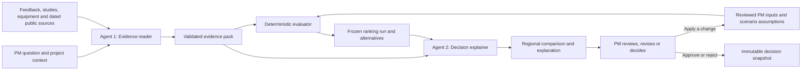

# Feature decision workspace — proposed logic and interface

Design for review, 10 October 2026. This document specifies the intended behavior; it does not describe completed application functionality. The [interactive wireframe](decision-workspace.html) contains no customer data and makes no live recommendations.

The product helps a PM answer: **For this vehicle, feature, market and launch, what customer outcome should we improve, which actions deserve priority, and what must we know before choosing one?**

The unit of assessment is **feature × proposed action × market × project version**. A generic feature score cannot distinguish improving a poorly implemented capability from adding a capability, retaining it, removing it, or changing its regional availability.

This design follows the local BMW briefing, [repository rules](../AGENTS.md), [PRD](../BMW_Decision_Studio_PRD.md) and [MVP](../BMW_Decision_Studio_MVP.md), with the repository overrides and the user's requested regional workflow taking precedence. It contains no BMW feedback, data-derived statistics or invented customer evidence.

## 1. The decision flow



There are two language agents. The evaluator between them is ordinary Python code. Neither agent calculates scores, predicts sales, establishes engineering feasibility, or applies a decision.

The evidence is the **baseline for deliberation**: the explainer receives what is known, what contradicts it, what the PM has already accepted, and the current calculation results. It does not answer with a list of semantically similar documents. This use of “prior” does not imply a statistical probability distribution or permission to substitute one market's feedback for another's.

The normal interaction is:

1. Enter a feature question; confirm the resolved vehicle, capability, markets, powertrain and launch year.
2. Inspect exact evidence and coverage for each market.
3. Review proposed customer requirements and possible actions.
4. Supply or review importance weights, constraints and assumptions.
5. Compare regional priorities and feasible portfolios.
6. Apply a change and inspect the resulting new run.
7. Approve, reject or request revision with a name and rationale.

## 2. Context and evidence contract

Every retrieval and calculation receives the same frozen `DecisionContext`:

| Field | Behavior |
| --- | --- |
| Project and vehicle | Explicit project ID, predecessor vehicle and intended successor; no implicit default vehicle |
| Feature | Canonical capability ID, component/category relationships and any ambiguity confirmed by the PM |
| Markets | Separate selected markets; countries remain visible within each market |
| Powertrain and variant | Apply consistently to both numerator and denominator; unavailable breakdowns remain unknown |
| Evidence period | Exact source period where available; unknown dates are disclosed |
| Launch year | A project setting, normally within the briefing's three-to-five-year planning horizon |
| Future scenario | A named, versioned assumption set, separate from the portfolio strategy |
| Baseline action | Current product configuration or a PM-defined baseline; unknown availability stays unknown |
| Versions | Source hashes, extraction/review versions, taxonomy version and PM configuration version |

Do not assume the existing VFC hierarchy has a node for every requested capability. For example, a PM can ask about steering-wheel heating while the source classification is broader. Preserve the original category/component/issue labels and add an explicit capability mapping with provenance.

**Relevance and stance are separate fields.** A direct excerpt can support or contradict an action. Use `relevance = direct | parent_context | analogous | unrelated` and `stance = supports | contradicts | mixed | neutral`. Counterevidence must not disappear because it is negative for the proposed action.

| Evidence relationship | May contribute to a feature's direct feedback metrics? | Presentation |
| --- | --- | --- |
| Exact capability and applicable scope | Yes, after classification review or explicit PM acceptance of a labeled model-assisted interpretation | Direct evidence |
| Broader component or overall vehicle experience | No | Related context |
| Other vehicle, region, period or configuration | No; PM-accepted transfer may inform a separate assumption, never observed local counts or denominators | Analogous evidence with scope difference |
| Unrelated text | No | Excluded with a retrieval reason |

Do not expand direct evidence to parent-component feedback when exact evidence is scarce. Sparse evidence is a result, not a retrieval failure to conceal.

### Agent 1: Evidence reader

The reader resolves meaning and proposes structured claims. Each claim contains:

- Claim ID and customer outcome, with the original statement preserved locally.
- Source ID, file/sheet/row or PDF page; public material also has an exact URL, publication date and access date.
- Vehicle, market, powertrain, source period and configuration applicability.
- Feature mapping, relevance and stance.
- Signal: defect, difficulty of use, explicit request, praise, other or unknown.
- Evidence of stated impact; missing severity remains missing.
- Classification origin: source label, rule, model proposal or human correction.
- Review status, supporting excerpt IDs and any conflicting evidence.

Extraction confidence describes uncertainty about classification. It is not customer importance, representativeness, engineering feasibility or purchase probability. The model may propose a textual impact class; deterministic lookup and a reviewed rubric assign numerical values.

Validate cited IDs, locators, excerpt membership and context server-side. An existing citation alone does not prove entailment: validate scope and retain human review for interpretation. Treat all retrieved source text as data, including text that appears to issue instructions.

### Deduplication and denominators

Use the original feedback ID to join classification rows; scope identity by source file/version and source family where required to avoid collisions. Preserve each classification edge, but count a feedback record once per feature/action/cohort. A record may contain multiple signals, so signal columns are not necessarily additive.

Retain Source A–D as anonymous source families. Do not rename them as public reviews, dealer reports or a particular survey without documented provenance. Flag potential repeated or syndicated comments across families; an analyst reviews uncertain duplicate matches.

Every feedback metric shows the matching sample size, countries/market mix, source-family mix, powertrain coverage and classification provenance. These are counts of **feedback records**, not verified unique customers. Retain unclassified rows in coverage and disclose how they affect the eligible base.

The default view describes this dataset. Population inference would require a justified sampling and adjustment method; a large sample alone does not establish representativeness. This design follows AAPOR's emphasis on sampling methods and transparent analysis of nonprobability samples. [AAPOR best practices](https://aapor.org/standards-and-ethics/best-practices/)

## 3. From evidence to possible actions

The reader first identifies a customer outcome, such as control comfort or ease of using an existing function. Then it proposes distinct actions for PM review.

| Action | Evidence to examine | Inference to avoid |
| --- | --- | --- |
| Improve an existing capability | Direct complaints, usage context, stated impact, existing configuration | A complaint means the capability should be removed |
| Add or extend availability | Explicit requests, unmet outcome, verified regional/trim availability | A request proves the capability is absent everywhere |
| Retain a strength | Direct praise and evidence of what customers value | Praise cancels out another customer's serious problem |
| Change implementation or material | Feedback tied to that component/material and reviewed engineering constraints | General interior sentiment proves a material is suitable for this component |
| Offer a regional variant | Distinct local evidence and a feasible shared/variant architecture | Little feedback means a market does not want the feature |
| Remove or omit | Explicit PM baseline comparison, documented trade-offs and counterevidence | Silence proves there is no customer value |
| Investigate | Missing, contradictory or weakly applicable evidence | Unknown means low priority |

A complaint and a request are different signals, but neither receives automatic precedence. A serious recurring failure may deserve priority over a convenience request. An important unmet need may deserve priority over a mild annoyance. The common customer-outcome rubric makes that comparison explicit.

Requirements remain customer-facing. Engineering owns feasibility, dependencies and verification planning. A proposed material, temperature, timing target or design detail remains a candidate until supported and reviewed; the language model does not invent a validated specification.

## 4. Priority logic

Maintain three independent outputs:

1. **Customer and strategic value:** priority under the chosen PM preferences and future scenario.
2. **Evidence readiness:** direct coverage, review state, source diversity, applicability, contradictions and missing information.
3. **Delivery eligibility:** cost, budget, blockers, dependencies, exclusions and reviewed feasibility.

A high-value item can require research. An item with extensive evidence can be low-value. A feasible item can still be unimportant. Do not bury those differences inside one confidence-adjusted score.

### Step A — calculate scoped evidence descriptors

For action `a` and market `m`, define `N_m` as the eligible unique feedback-record base for the exact context, and `n_a,m` as the unique records directly supporting the customer outcome addressed by the action.

```text
observed support rate(a, m) = n_a,m / N_m
observed signal rate(type, m) = distinct direct records of that type / N_m
```

Rates are unavailable when the eligible base is unavailable or zero. In a fully processed, nonempty cohort, no direct matches gives an observed sample count of zero; it does not prove no customer need. Incomplete ingestion or unresolved mapping is unknown, not zero.

Show complaints, requests and praise separately, with links to the underlying records. Do not add overlapping classifications or repeated excerpts into a larger support count. Show within-feature signal composition separately from prevalence in the overall eligible feedback sample.

No cross-market shrinkage is enabled by default. A future statistical pooling method would need a documented transfer model and validation; it could not turn an unobserved region into observed demand.

### Step B — derive customer value using an explicit rubric

The following is a **proposed PM planning rubric**, not a calibrated BMW model. All constants and mappings must be versioned and visible. It gives engineering an implementable starting point without allowing an LLM to choose numbers.

```text
F(a, m) = 100 × min(1, observed support rate(a, m) / T)
C(a, m) = I(a, m) × (0.60 + 0.40 × F(a, m) / 100)
```

`T` is a positive, PM-approved saturation threshold in feedback-record share. It is frozen across comparable actions and runs, not fitted to the current result list. No numeric default for `T` is claimed to be validated. Without an accepted threshold, show descriptors and await rubric review.

`I` is the reviewed customer benefit this action can deliver or preserve, on a common fixed scale for improvement, addition and retention. Consider both the importance of the outcome and how well this action addresses it; a weak remedy must not inherit the full importance of a serious problem. Specify a consistent reference configuration within each compared outcome/option group. Retention value concerns the explicit omission trade-off, not an invented incremental improvement over an unchanged product. Candidate anchors:

| I | Reviewed customer-outcome interpretation |
| --- | --- |
| 0 | An explicit assessment finds no material customer benefit in the proposed action |
| 25 | Minor comfort, appearance or convenience benefit |
| 50 | Meaningful improvement to a recurring customer task or experience |
| 75 | Restores or enables an important customer task that is substantially impaired or unmet |
| 100 | Addresses a customer outcome explicitly accepted by the PM as essential to the intended product experience |

Missing impact is unknown, never 0. Each impact assessment stores reviewer, rationale and supporting/countervailing claims. These anchors express planning judgments; they are not measured intervals of human satisfaction. The PM reviews an action's benefit instead of the system letting one extreme adjective determine it. Frequency moderates that reviewed benefit; it cannot give positive customer value to an action assessed as providing no benefit. The 0.60/0.40 allocation is a proposed planning assumption, not an evidence-confidence multiplier or an empirically fitted coefficient.

A linked study can corroborate or challenge the impact assessment. Keep original question wording, scale, population and exact cells. An overall suitability score or a broad seating attribute is contextual evidence for a specific subfeature unless the mapping is justified. Do not convert regional study scales into interchangeable values without a documented accepted mapping, or infer feature causality from overall satisfaction. Avoid counting the same study again as an independent popularity bonus.

If no usable feedback rate exists, customer value remains incomplete. The PM may accept a specific study-based or expert customer-value assumption with its own derivation and label; the system must not silently switch scoring methods.

The frequency term is consciously a **sample-based planning proxy**. Keep market comparisons conditional on source mix and coverage; do not describe this value as measured population demand.

### Step C — calculate a comparable regional priority

Retain the MVP's common criteria so regional decisions can feed portfolio generation:

```text
priority(a, m, scenario, profile) =
    w_customer × C
  + w_future × Future
  + w_delivery × Delivery
  + w_region × RegionalFit
  + w_experience × Experience

all weights >= 0; sum(weights) = 1; each criterion is on a fixed 0–100 rubric
```

| Criterion | Owner and derivation |
| --- | --- |
| Customer value | Deterministic calculation from the accepted rubric and reviewed evidence/impact inputs above |
| Future relevance | Reviewed scenario lookup for the configured launch year; labeled scenario evaluation |
| Delivery maturity | Engineering-reviewed maturity/risk assessment; a preference criterion distinct from hard blockers |
| Regional fit | Reviewed applicability to local use conditions and target users; evidence references or explicit assumptions |
| Product experience | Named PM/expert assessment against the intended vehicle experience; labeled assumption |

Use the **same comparison weights** for FIX, ADD and RETAIN candidates. Action type does not choose a more favorable scoring formula. Frequency already enters customer value; do not also multiply regional fit by the same frequency. Evidence coverage is displayed separately and does not numerically discount priority.

Where an active criterion is unknown, either await review or show a provisional score range:

```text
known contribution = sum(weight × known criterion value)
lower bound = known contribution
upper bound = known contribution + 100 × sum(weights of unknown criteria)
```

These bounds are possible scores under unresolved rubric inputs, not confidence intervals or probabilities. Do not replace missing inputs with 0, 50 or a redistribution of the remaining weights. Fully known scores can be ranked; overlapping incomplete ranges do not establish a definite order. Unknowns with zero weight remain disclosed but do not change the score.

Expose every contribution and its source or assumption. Resolve exact score ties by stable requirement/action ID. Adding an unrelated candidate must not alter another candidate's score.

### Step D — evaluate hard constraints and alternatives

Reviewed feasible, unresolved and blocked are separate states. Unknown development cost or feasibility prevents a definitive feasibility label. A named PM can accept a specific planning estimate or feasibility assumption, with rationale; this remains visible. A known blocker cannot be waived by changing its label.

Budget and development costs come only from PM inputs. Retail option prices cannot fill these fields. Enforce mandatory items, dependencies, exclusions and shared enabling costs; count each shared cost once. Return **No feasible portfolio** with the conflict only when no selection can satisfy all hard constraints. An exclusion between optional actions normally creates different alternatives, rather than making the whole project infeasible.

For a shared feature and regional variants, represent the common implementation and each incremental variant as explicit dependent requirements. Declare mutually exclusive actions, including retain versus remove for the same capability/market. Do not double-count customer benefit for overlapping actions serving the same outcome: either make them exclusive or require a reviewed incremental-benefit model.

Generate customer-led, future-led, experience-led and cost-disciplined alternatives using the existing MVP contract. Deduplicate identical selections, exclude dominated results under common comparison criteria, and show fewer alternatives when fewer exist. Generation weights explain how an option was found; common comparison weights make the options comparable.

Resolve positive-weight unknown criterion values through reviewed inputs or explicit accepted assumptions before claiming a definitive portfolio ranking. Candidates with incomplete values remain visible in the investigation queue; excluding them must be disclosed, and results can only be called best within the reviewed candidate set. Do not feed arbitrary endpoints of provisional score ranges into the optimizer. A future optimization method for incomplete values needs its own documented algorithm and result labels. An unresolved mandatory item prevents definitive generation.

For a multi-market project, preserve regional scores first. Any project-wide aggregation uses explicit PM market weights that sum to one. A PM can choose a documented projected-volume weighting basis, but this is a planning preference, not a statistical correction to feedback. Never let a larger feedback sample implicitly choose the project's market strategy.

Evaluate portfolios under each configured future scenario using common weights. Report scenario feasibility, utility and worst-case utility, plus regret when computed. Do not describe the outcomes as probabilities. Applying a new future assumption creates a new run and can change priorities and selections.

## 5. Answering the PM's questions

| Question | Supported answer | Boundary and next input |
| --- | --- | --- |
| How many need it? | Direct requests/complaints in the scoped feedback, sample denominator and linked study findings | These records do not identify total market demand, take rate or unique buyers |
| Have it or omit it? | Compare explicit baseline and candidate actions, value contributions, counterevidence and delivery constraints | Absence of praise is not a removal case; consequences of omission may be unknown |
| Which regions? | Separate local evidence, suitability assessment and proposed action for each selected market | Missing regional evidence means investigate; it does not mean unsuitable |
| Which material? | Feature-specific customer preferences and documented available alternatives | Engineering must review durability, tactile performance, manufacturing and other applicable constraints |
| How many markets are affected? | Distinguish markets with evidence, markets proposed for rollout and markets whose configuration actually changes | Count distinct selected markets; do not count multiple countries as multiple configured regions |
| How many vehicles are in scope? | Relevant observed sales or dated BMW projected volume with matching vehicle, region and year | Potential exposure is not feature fitment volume or additional sales; missing trim/powertrain splits stay unknown |
| How many more cars will sell? | Unknown from feedback frequency and these source tables alone | Requires an accepted causal model or an explicit conditional PM scenario |
| What if we do nothing? | Unresolved customer problems and the retained baseline, plus accepted scenario assumptions | Do not assert lost sales, attrition or a worsening trend without supporting evidence |
| What do rivals offer and how do they sell? | Dated, market/trim-specific public specifications and separately sourced sales measures | Coexistence of a feature and strong sales does not establish that the feature caused the sales |

### Optional sales scenario

The default incremental-sales answer is **Unknown**. For an explicit PM what-if, define a reference configuration and sales baseline, then accept market-specific signed changes relative to that reference:

```text
sales_if_implemented(m) = baseline_units(m) × (1 + delta_implemented(m))
sales_if_omitted(m) = baseline_units(m) × (1 + delta_omitted(m))
conditional_difference(m) = sales_if_implemented(m) - sales_if_omitted(m)
```

The baseline must state whether it already assumes the feature, and the assumptions must match that definition. Both deltas are PM inputs with reviewer and rationale; no LLM defaults and no conversion from mention rate. Validate finite inputs, nonnegative baseline and nonnegative resulting sales. Low/base/high cases are explicit assumptions, not statistical bounds.

The result is labeled **scenario evaluation — assumed effect, not a sales forecast**. Future BMW volume is a projection and retains its source year. Selecting another launch year does not relabel an existing projection or silently interpolate it. If required inputs are unavailable, retain Unknown.

Do not sum independently estimated feature effects into a portfolio sales prediction; effects may overlap or interact. A portfolio prediction requires a separate reviewed model. Sales modeling is an optional aid, not the main customer-requirements deliverable.

## 6. Public competitor research

Start with a bounded, PM-requested research question: capability, market, comparison segment, price/positioning boundary, relevant model year and date. Use public context only in search queries. Keep BMW source excerpts out of search engines and other external destinations.

Prefer regional manufacturer specifications, configurators and dated price lists for equipment; primary registrations or company reports for sales; original published studies or attributable reviews for customer experience. Reviews show reported experiences, not an automatically representative demand estimate.

Each fact records model, trim, market, powertrain, model year, availability status, publication/access dates, URL and excerpt locator. Store the sales metric definition: deliveries, registrations and wholesale units are different quantities. A sales period or model-family scope mismatch is visible, not quietly merged.

The comparison table separates feature availability, customer experience and sales performance. Related competitor success can motivate research, but it cannot prove a causal uplift or engineering feasibility for BMW. Missing public information stays unavailable.

Use curated sources or a bounded user-triggered research action. This design does not require a live crawler, autonomous browsing agent or OCR pipeline. Public facts are reviewed before entering priority inputs; retrieved pages cannot change project instructions.

The app may send BMW excerpts only to its configured backend OpenAI service, consistent with repository rules. A public source collection step and the confidential evidence explanation step need separate data boundaries.

## 7. Agent 2: Decision explainer

The explainer consumes the validated evidence pack, PM decision history relevant to this version, and a frozen evaluator result. It produces structured fields:

| Output | Content |
| --- | --- |
| Decision statement | Specific feature/action, vehicle, markets and horizon |
| Regional assessment | Proposed action, direct evidence, counterevidence, score contribution references and readiness |
| Trade-offs | What an alternative improves, sacrifices or leaves unresolved |
| PM input effects | Which accepted choice changed a contribution, constraint or selected item |
| Unknowns | Missing facts, studies, cost, feasibility or causal evidence, with a concrete next check |
| Reconsideration triggers | New local evidence, a changed engineering estimate, contradictory study or scenario reversal |
| Proposed change | Typed proposed PM-input patch with explanation; unapplied until the PM acts |

Numerical fields reference stored metric IDs and values. The UI renders the actual values from the frozen result; do not ask the explainer to retype or calculate them. Factual sentences require validated excerpt references. A strong brief identifies what could change the recommendation, not just evidence in its favor.

If extraction fails, identify the affected source and claim. If explanation generation fails, show the evaluator result and evidence with **Decision explainer unavailable**. A deterministic result must be identified as such; do not present a template as a live agent answer. Reproducibility depends on frozen reviewed extraction outputs as well as source/configuration versions, not a promise that repeated language-model calls will be identical.

## 8. Interface specification

The workspace starts with the decision and an aligned regional comparison. Agent progress is secondary and reflects real completed work; no staged playback presented as live reasoning.

```text
Project / vehicle / feature / launch year / target markets / draft or run ID
Future scenario: [active assumptions]       Strategy: [comparison profile]

Decision under review                    Priorities | Alternatives | Changes

Market | Direct feedback | Study | Value | Evidence | Delivery | Proposed action
       | complaints / requests / praise, with sample and source mix

Selected action: customer outcome, criteria contributions and unresolved inputs
Supporting evidence | Counterevidence | Related context

PM inputs: weights, costs, budget, feasibility, constraints and scenario assumptions
                                      [Apply and recalculate] [Review decision]

Contextual explainer: why / why not / what changes / what is missing
```

**Context bar.** Vehicle and launch year are explicit. Distinguish the source observation year, projection year and intended launch. The future scenario and portfolio strategy have separate controls.

**Regional table.** Aligned rows expose direct complaints, requests and praise; sample and source mix; study applicability; priority or incomplete range; projected exposure; cost and delivery state; proposed action. A cell opens the underlying evidence or derivation. A missing region is displayed, not removed from the comparison.

**Evidence drawer.** Direct support, direct counterevidence, related context and assumptions are distinct sections. Show exact locators and original scope, source labels, deduplication status and human corrections. A PM can exclude a misclassified claim and see the change only after recalculation.

**Value panel.** Show contribution bars with numbers, fixed rubric, evaluator/reviewer and provenance. Keep evidence readiness and delivery eligibility in separate panels; status always has words/icons in addition to color.

**Engineering panel.** Cost, cost basis, reviewed feasibility, dependencies, exclusions, shared enablers, blockers and verification questions. Proposed materials are candidates, with suitability unknown until reviewed.

**Alternatives view.** Compare real selected requirement sets, regional variants, spend, customer outcome, future scenario results and unresolved assumptions. A single-feature action comparison is distinct from a full requirement portfolio; the PM can add an action to the project registry and recalculate the portfolio.

**What-if view.** Edited inputs are a pending proposal. Apply and recalculate freezes a new run; compare additions/removals, contribution changes, changed feasibility and assumption versions with the preceding run.

**Review screen.** Reviewer and rationale are required for approve/reject/request revision. Approval references the selected feasible portfolio, acknowledged planning assumptions and immutable source/run snapshot. Editing an approved item creates a draft revision. Export reads the approved snapshot, not the latest draft.

Use `observed`, `assumption` or `scenario evaluation` beside values and claims. `Unknown` is an explicit availability state with no invented value. Derived descriptive metrics identify their observed inputs and formula; projected source values also retain a visible projection qualifier. Observed equipment availability is only for the documented market/trim, not automatically every region.

The [wireframe](decision-workspace.html) demonstrates navigation, evidence inspection and local draft input changes. It deliberately contains empty evidence states and does not simulate an approved decision or loaded BMW data.

## 9. Implementation implications and verification

The current app is a FastAPI package with plain HTML/JavaScript, while repository instructions name a Next.js/TypeScript frontend and `backend/` layout. Implementation must explicitly reconcile that difference; this design does not silently migrate the stack. The architecture and data contracts above apply to either layout.

The requested EU/China/US comparison extends the older MVP's one-region release limit. It is included here as the user's product direction; implementation can phase delivery by keeping the same regional context contract and first demonstrating a selected subset.

Concrete changes required before the existing app can claim this behavior:

| Existing area | Required change |
| --- | --- |
| `pm_copilot/brief.py`, `_select` | Remove sparse-feature fallback into parent-component evidence; retain context separately |
| `pm_copilot/inquiry.py`, `run`; `requirements.py`, `score_feature` | Pass one context object into all evidence selection, denominators, scores and explanations; recalculate by market |
| `pm_copilot/config.py`, `SOURCE_KIND` | Preserve anonymous source families unless documented metadata establishes their meaning |
| `pm_copilot/scoring.py` | Replace implicit neutral values, categorical feasibility proxies and automatic complaint precedence with reviewed rubrics and visible unknowns |
| `pm_copilot/scoring.py`, `sales_scenario` | Separate observed/projected exposure from PM sales-effect scenarios; remove inferred purchase sensitivity |
| `pm_copilot/store.py` and ingestion | Preserve exact study/feedback cell or row locators, raw scale, source version, geography and equipment applicability |
| `pm_copilot/research.py` | Replace the existing non-OpenAI provider paths and enforce the approved data boundary before use |
| `pm_copilot/db.py` | Preserve approved snapshots; new calculations and edits create new draft versions |
| `frontend/app.js` | Lead with regional decisions and inspectable contributions; distinguish actual processing from static result explanation |

A coherent build follows MVP order: validate ingestion and evidence identity; create reviewed action requirements; implement pure scoring/constraints and honest alternatives; link future scenarios; build comparison/evidence UI; add grounded explanation and what-if; finish immutable decisions/export. Regional scope belongs in the early contracts even if the first demonstration selects one market.

Acceptance examples extend the existing gates:

- **A1:** Repeating a real classification row changes no feedback count. Unknown classifications and malformed rows remain visible.
- **A2:** Identical frozen evidence, PM settings and versions reproduce scores, ordering and selections. Adding an unrelated candidate changes no existing score.
- **A4/A5/A6:** A conflicting mandatory requirement, missing dependency, known blocker, insufficient budget or unknown cost never produces an unjustified feasible label.
- **A7:** Changing a reviewed future driver creates a new run, exposes the contribution change and can change selections.
- **A8/A9/A10:** A sparse subfeature never borrows its parent's counts; an unobserved region never receives another region's demand as fact; every number and factual claim resolves to evidence or a stored derivation.
- **A11/A12/A13:** Approval remains unchanged after input edits, evidence refresh or re-scoring; the export exactly matches the approved version.
- **A14:** Only distinct, non-dominated feasible portfolios are displayed; fewer than four is an explained result.
- **Regional consistency:** Numerator, denominator, study population and decision all use the declared scope. German equipment status cannot establish Chinese availability.
- **Missingness:** Missing surveys or active criterion inputs remain unknown, rather than becoming neutral values. Weak evidence produces a visible validation need.
- **Sales:** Default incremental sales is unknown. Conditional scenario results change only from explicit PM inputs and retain the correct baseline/projection year.
- **Explanation failure:** Invalid citations are rejected and model outage leaves deterministic results and evidence usable.

Data-dependent tests build subsets of the real files at test time and skip clearly when those files are absent. Pure constraint tests can use small PM-style requirement inputs without customer evidence. No new source-derived data belongs in tracked fixtures or documents.

Before operational use, PMs must approve the customer-value saturation threshold, impact rubric, comparison/market weights, scenario mappings and any accepted cost or feasibility assumptions. These are explicit editable planning choices, not facts supplied by either agent.
