# BMW customer feedback: data report and roadmap

**Scope:** BMW 1 Series (F70), 5 Series (G60) and 7 Series (G70) hackathon data.
**Goal:** a pipeline that takes customer feedback about a feature and tells a product manager whether the feature is good or bad, and why.

All numbers in this report are produced by `python -m bmw_feedback all`. They can be checked in `reports/*.csv`, `reports/*.json` and `reports/figures/`.

---

## 1. Summary

1. **The data supports the PM pipeline.**
   - There are 10,128 customer comments, and 8,948 of them carry human labels for three things:
     - which feature the comment is about (VFC level 2, 224 features);
     - whether it is praise, a defect, a usability problem or a request (Feedback Type);
     - why (VFC level 3, 84 reasons).
   - Taken together, these labels are the "good/bad + why" signal.
2. **Never use the raw "% positive".**
   - The four feedback channels have completely different base rates. Source C (a problem survey) contains no praise at all.
   - The models are heard through different channels: the F70 is covered only by Source A.
   - The pipeline therefore scores every feature against what its channel mix predicts. This gives a **complaint index**, where 1.0 means "as expected" (Section 5).
3. **Annotators park praise on umbrella labels.**
   - "Exterior design" has 391 comments and 0 complaints. Specific components almost only collect complaints.
   - Specific features are therefore compared only with other specific features.
4. **Result for the 208 specific features:**

   | Verdict | Features |
   |---|---|
   | Bad | 9 |
   | Leaning bad | 49 |
   | Mixed | 82 |
   | Leaning good | 17 |
   | Good | 9 |
   | Not enough data | 42 |

   - **Clearly bad:** climate control, Personal eSIM, driver profiles, small-item storage.
   - **Clearly good:** seats, My Modes, damping, ambient light, cabin and engine acoustics.
5. **Complaints by domain:**
   - Complaints concentrate in ownership topics (manual, 12 V battery), connected apps, doors/access, infotainment & HMI and EV charging.
   - Chassis & driving dynamics is the clear strength.
   - Drivetrain and exterior also look strong, but mostly through umbrella praise ("great engine", "beautiful design"). Their specific components score about average (Section 4.2).
   - Most complaints are **usability**, not defects: "hard to use / confusing" is the largest reason in every domain except Drivetrain and Interior & storage.
6. **A simple text classifier already routes new comments well.**
   - TF-IDF + logistic regression scores micro-F1 0.81 on feedback type, 0.73 on domain, and 68% top-1 / 87% top-3 on the feature.
   - It degrades when moved to an unseen channel, to 0.64–0.68 on feedback type. That gap is the main thing to fix next (Section 6.2).
7. **Biggest caveats:**
   - The feedback is 92–97% US for G60/G70, and there is no Chinese feedback at all.
   - There are no dates, so trends over time are impossible.
   - Survey and free-text complaints agree only weakly (Spearman rho 0.20).

---

## 2. What is in `BMW-Data/`

| File | Content | Used for |
|---|---|---|
| `F70/G60/G70_feedback_hackathon.xlsx` | 13,771 rows. Each row is one (comment, label) pair: ID, Source A–D, Country, model, engine (ICE/BEV/PHEV), Feedback Type, comment text, VFC level-2 + level-3 label | Core training data and verdicts |
| `F70_G60_G68_G70_customer_studies.xlsx` | `CN_EU_2025`: mean satisfaction (0–10) on 37 attributes for EU F70/G60/G70 and CN G68/G70. `US_2025`: 7-point distribution ("I Hate It" … "I Love It") on 103 attributes for G60/G70 | Cross-checking verdicts against structured surveys |
| `sales_volumes.xlsx` | Volume by market (EU, CN, US, RoW) for 2024, 2025 and 2030 per model group | Representativeness and impact weighting |
| `*_OptionList.PDF` | German price lists (July 2026): standard equipment, options with SA code and price, per engine variant | Linking a verdict to price and standard-vs-optional status |

**Repository layout after the clean-up.** The procurement (Demandra) code was moved to the git-ignored `archive/legacy_procurement/` and is also in git history.

```
bmw_feedback/          pipeline package (python -m bmw_feedback ...)
  config.py            paths, constants, verdict thresholds
  taxonomy.py          11 domains <- 224 features; 21 reason families; survey + option-list maps
  load.py              Excel readers (feedback, CN/EU + US survey, sales)
  clean.py             text cleaning, leakage removal, label + comment tables
  scoring.py           channel-adjusted feature verdicts
  classifier.py        TF-IDF + logistic regression (feedback type / domain / feature)
  option_catalog.py    coordinate-aware price-list parser (PyMuPDF), validated on every build
  risk_model.py        explainable boosting machine for complaint drivers
  decision.py          idea -> per series x market recommendation, policy, decision log
  api.py               FastAPI backend for the web app in frontend/
  verdict.py           PM verdict cards (feature name or free text)
  figures.py           all charts in reports/figures/
  cli.py               build | train | figures | export | verdict | serve | all
reports/               REPORT.md, figures, scorecards, metrics (tracked)
data/processed/        cleaned tables (generated, git-ignored)
models/                trained classifiers (generated, git-ignored)
```

The old pipeline's ideas carry over directly:

| Old Demandra idea | BMW equivalent |
|---|---|
| E-Class → +Manufacturer → +Feature cluster | Domain → Feature → Feature + Reason |
| Cold start: borrow from similar buyers | Small features borrow from their domain |
| Economic filter | Volume and market weighting |

---

## 3. Data quality: what was wrong and what the pipeline already fixes

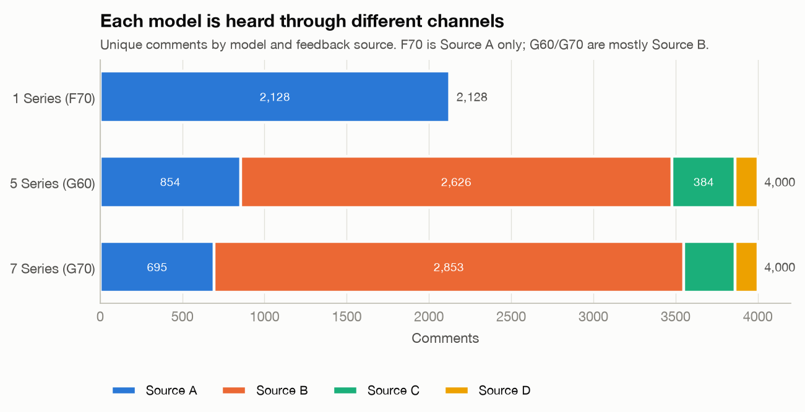

| # | Issue found | Scale | Fix in `clean.py` / `scoring.py` |
|---|---|---|---|
| 1 | **Row ≠ comment.** A comment with k labels is repeated k times (up to 17 labels) | 13,771 rows → 10,128 comments; 11.9% of labelled comments are multi-label | Two tidy tables: `labels` (one row per label) and `comments` (one row per comment, label sets as lists). Volumes are counted in comments, not rows |
| 2 | **`no_class_found` placeholder rows.** Most sit next to real labels; 780 comments have nothing else | 2,082 rows | Dropped from labels. The 780 "ncf-only" comments go to the unlabelled pool |
| 3 | **No label at all** (Source D entirely, part of Source C) | 400 comments | Unlabelled pool (1,180 comments in total); classified by the trained model |
| 4 | **Label leakage in Source C.** Text starts with `I had a serious problem with Parking brake - DTU/controls poorly located: "…"` | 571 comments | Prefix stripped; severity (very minor … very serious) and problem code kept as structured columns |
| 5 | **Survey prompts in Source C** ("What is the primary reason for your NPS rating?") | 126 comments | Stripped; prompt type kept |
| 6 | **Template in Source D** ("… That is the one thing I love most / could be most improved about the interior of my vehicle") | 273 comments | Stripped. Topic and stance (213 "love", 60 "improve") kept as weak labels |
| 7 | **Call-centre notes in Source B.** Boilerplate "Customer stated that…", the advisor's reply ("Writer explained…", including typos like "Wrtier") and chatter ("Customer acknowledged.") | 5,479 comments | Removed sentence by sentence |
| 8 | **Casing reveals the channel.** Source A is 99% lowercase, the others 0% | all | Model text is lowercased |
| 9 | **Non-breaking spaces in labels** (`ground\xa0clearance`) | 19 rows | Normalised |
| 10 | **Feedback Type missing although a real label exists** | 18 rows | Imputed from the reason wording ("Not user-friendly" → Difficult to Use) |
| 11 | **"Wants" rows with complaint-worded reasons** ("Dislike: price-performance ratio") | 111 rows | Feedback Type kept as polarity (human judgement of intent); flagged `flag_request_with_complaint_reason` |
| 12 | **EV-only features labelled on ICE cars** (range, charging) | 36 rows | Flagged, not dropped. Usually comparisons with a previous EV or mild-hybrid talk |
| 13 | **Redundant / constant columns** (Brand, Sales Description, `Vfc level2 3 Name`) | n/a | Dropped. `Vfc level2 3 Name` = L2 + " : " + L3 apart from 5 whitespace variants |
| 14 | **Duplicate short notes across IDs** ("he appreciates the touchscreen design.") | 45 texts | Deduplicated before classifier training |
| 15 | **Channel confound.** Source C has 0% Likes; F70 is Source A only | all | Verdicts are standardised by source (Section 5) |
| 16 | **Umbrella-label asymmetry.** Praise goes to "Exterior design", "Drivetrain" etc.; complaints go to components | 16 umbrella labels | Specific features are compared with specific features only |
| 17 | **One empty answer read as missing** (a Source D answer was literally "None.") | 1 | CSVs are read with `keep_default_na=False` |

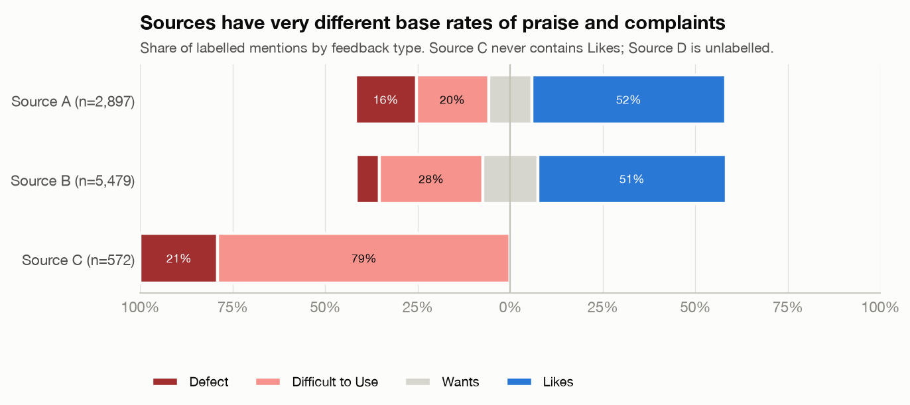

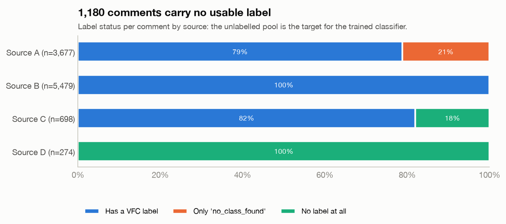

### Further cleaning, in order of value

1. **Audit level-3 reasons with a small gold set.**
   - Several reasons are clearly misused. On the F70 touch screen, "Damage" is used for *software crashes*, and "Size not user friendly" (62 rows) is really "touch-only operation / missing rotary dial".
   - One "Electric Range" request is actually about heating controls.
   - Re-label ~300 stratified comments, measure agreement, and fix systematic mappings in `taxonomy.REASON_FAMILIES`.
2. **Split multi-aspect comments into clauses before labelling or scoring.**
   - 1,066 comments carry several labels, but the polarity is per comment, not per aspect. "Great ride, but the screen is distracting" gives both features both sentiments.
   - Sentence/clause segmentation plus aspect assignment (Section 6.3) removes this noise from the verdicts.
3. **Use Source D's stance as a weak label.** The trained classifier calls 51 of the 213 "love" answers complaints. For example, "Doors pop open automatically as I walk up with the keyfob" is predicted as a Defect. The stance would correct these for free.
4. **Normalise third-person pronouns and the remaining narrative glue in Source B** ("he would like…") if a model is trained on mixed channels. Source A is first-person. Pronoun style is another channel fingerprint.
5. **Check translation artefacts in JP/KR comments.** These include `・` bullets, ▶, and odd phrasing ("the driving feel is firm and moist"). Keep a `language_origin` flag so translated text can be down-weighted or modelled separately.
6. **De-duplicate near-identical comments across IDs.** Use MinHash or cosine similarity > 0.9 to catch copy-paste notes beyond exact duplicates.
7. **Spell-correct conservatively** ("satsifying", "experiance", "dor handles"). Character n-grams already absorb most of this, so it matters mainly for keyword search and LLM prompts.
8. **Get dates.** Without a timestamp you cannot see whether an OTA update fixed CarPlay, or split pre- and post-facelift. This is the single most valuable field to request from BMW.
9. **Get the option code per vehicle (VIN-level build data).** Today you cannot tell whether a customer complaining about the HUD actually has the HUD. That matters for "is the option worth its price".

---

## 4. The categories

### 4.1 Three-level taxonomy (`bmw_feedback/taxonomy.py`)

| Level | What | Count | Source |
|---|---|---|---|
| Domain | Product area a PM owns | 11 | Hand-curated grouping of VFC level-2 |
| Feature | VFC level-2 label | 224 (16 umbrella + 208 specific) | Data |
| Reason | VFC level-3 label → reason family | 84 → 21 families | Data + hand-curated grouping |

The 11 domains are:

- Drivetrain & Performance
- Chassis & Driving Dynamics
- EV Charging & Range
- Driver Assistance & Safety
- Infotainment & HMI
- Connected Apps & Digital Services
- Seats, Comfort & Climate
- Interior Design & Storage
- Exterior Design & Body
- Doors, Access & Keys
- Ownership & Service

Reason families are split by polarity:

- **Positive:** function works well, performance & efficiency, easy to use, design & craftsmanship, comfort & space, sound, good value.
- **Negative:** hard to use, cannot be switched off, inaccurate information, malfunction / software fault, battery drain, build quality / damage, noise & vibration, performance / range shortfall, uncomfortable / too small, poor value / missing equipment.
- **Requests:** new function, easier use, different design/material, more performance/comfort.

### 4.2 Domain view

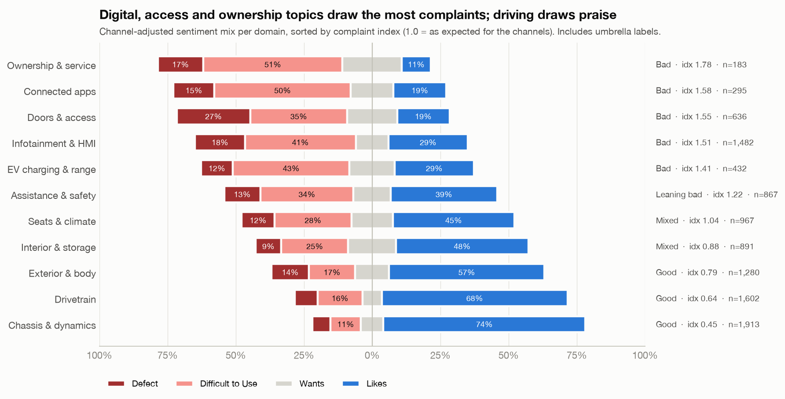

| Domain | Comments | Complaint index | Verdict | Defect vs usability mentions |
|---|---:|---:|---|---|
| Ownership & Service | 183 | 1.78 | Bad | 30 / 92 |
| Connected Apps & Digital Services | 295 | 1.58 | Bad | 48 / 161 |
| Doors, Access & Keys | 636 | 1.55 | Bad | 193 / 253 |
| Infotainment & HMI | 1,482 | 1.51 | Bad | 303 / 676 |
| EV Charging & Range | 432 | 1.41 | Bad | 53 / 194 |
| Driver Assistance & Safety | 867 | 1.22 | Leaning bad | 119 / 308 |
| Seats, Comfort & Climate | 967 | 1.04 | Mixed | 130 / 305 |
| Interior Design & Storage | 891 | 0.88 | Mixed | 92 / 239 |
| Exterior Design & Body | 1,280 | 0.79 | Good | 169 / 208 |
| Drivetrain & Performance | 1,602 | 0.64 | Good | 132 / 259 |
| Chassis & Driving Dynamics | 1,913 | 0.45 | Good | 126 / 213 |

**Robustness check: the same domain scores on specific features only.** Umbrella praise sits mostly in Chassis, Drivetrain and Exterior, so the table above flatters those domains. Re-scoring with umbrella labels removed gives a ranking that correlates at Spearman 0.79 with the one above:

- The three most-complained-about domains stay on top: Connected Apps 1.22, Ownership & Service 1.21, Doors, Access & Keys 1.15.
- Chassis & Driving Dynamics stays the best domain (0.82, Leaning good).
- **Exterior Design & Body falls from Good (0.79) to Mixed (1.08).** Customers praise the *design* in general, but specific exterior parts (mirrors, lighting, wipers) collect average or above-average complaints.
- **Drivetrain** moves to Mixed (0.96).
- **Seats, Comfort & Climate** improves to Leaning good (0.83).

Use the umbrella-inclusive view for "what do customers love about the car" and the specific-only view for "which components need work".

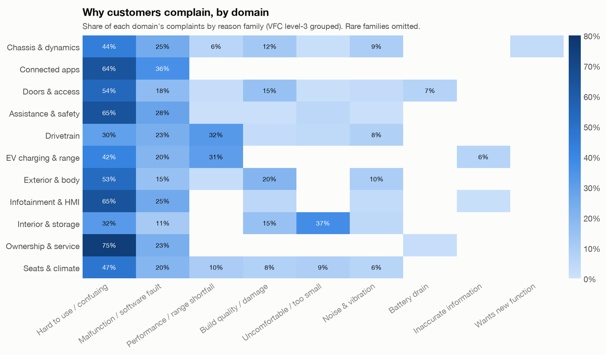

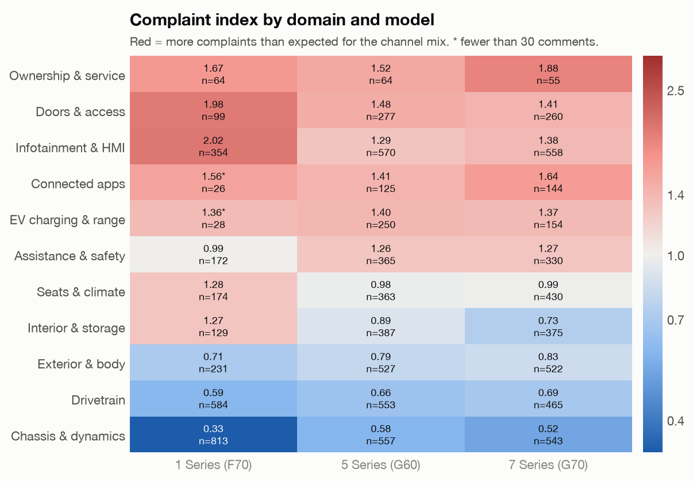

**Model differences worth a PM's attention:**

- **F70 infotainment** has a complaint index of 2.02, against 1.29 for G60 and 1.38 for G70. The feature-level breakdown shows why: the F70 touch screen is rated **Bad (1.26)** while the G60's is **Good (0.70)**. F70 owners miss the rotary controller and physical buttons.
- **F70 doors & access** is at 1.98 and **F70 seats & climate** at 1.28, both worse than the larger cars.
- **G70 climate control** is "Bad" (1.43, n=43) against 1.16 on the G60. The US survey agrees: 18% of G70 owners rate climate performance "Unsatisfactory" or worse, against 5.6% for the G60.
- **G70 Personal eSIM** is "Bad" (1.76, n=39). Across all models, 33 of 46 eSIM complaint labels are "Not user-friendly", and the quotes point to being tied to a single US carrier.

### 4.3 Feature view

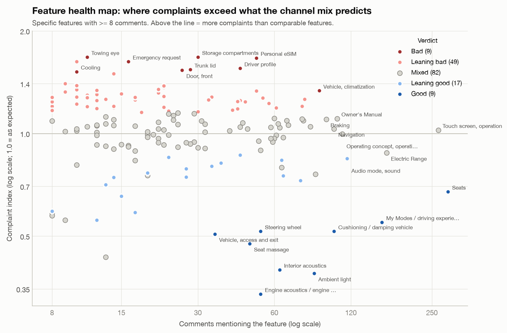

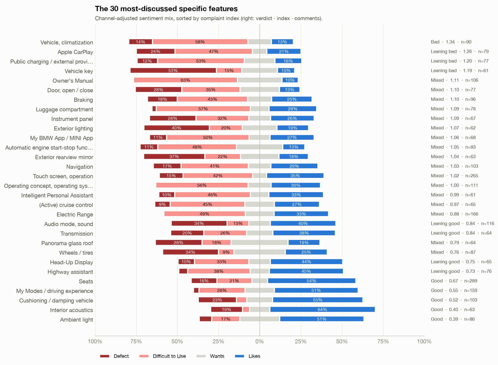

The full table is `reports/feature_scorecard.csv`: one row per feature with observed/expected counts, indices, 95% intervals, channel-adjusted shares, Defect vs Difficult-to-Use counts and the verdict.

---

## 5. How the verdict works (`scoring.py`)

**Unit.** One unit is one (comment, feature, sentiment). Sentiment is `positive` (Likes), `negative` (Defect or Difficult to Use) or `request` (Wants).

**Channel standardisation.** For each source *s*, compute the share *b_s(c)* of each sentiment among specific-feature units. A feature with *N_fs* units in source *s* is then *expected* to show

    E_f(c) = Σ_s N_fs · b_s(c)

units of sentiment *c*. The **index** is observed / expected. It is the same idea as a standardised mortality ratio.

**Shrinkage.** Small features are pulled toward their domain:

    index_f(c) = (O_f(c) + k · index_domain(c)) / (E_f(c) + k),   with k = 5

This is the "cold start" fallback. A feature with 3 comments inherits most of its domain's behaviour.

**Uncertainty.** A 95% interval on O/E (Byar's approximation).

**Verdict rules.** Thresholds are in `config.py`.

| Verdict | Rule |
|---|---|
| Not enough data | fewer than 8 comments. Show the domain verdict instead |
| Bad | complaint index ≥ 1.25 **and** the 95% interval lies above 1 |
| Good | complaint index ≤ 0.8, the interval lies below 1, **and** praise index ≥ 1 |
| Leaning bad / Leaning good | point estimate ≥ 1.15 / ≤ 0.87, interval still overlaps 1 |
| Mixed | everything else |
| + Requested | request index ≥ 1.5 with the interval above 1 (unmet need) |
| + Bad kind | defect-led (≥ 60% Defect), usability-led (≥ 60% Difficult to Use), or both |

**The "why" shown to the PM.** Each card contains:

- top reason families per sentiment;
- 2 representative quotes per sentiment, chosen as single-topic comments of medium length;
- breakdowns by model and engine;
- the matching US survey attribute;
- the option-list entry (price, SA code, standard/optional).

**Example card:**

```
$ python -m bmw_feedback verdict --feature "hud"
## Head-Up Display -> Leaning good
Infotainment & HMI | confidence: medium | 65 comments
Head-Up Display is rated 'LEANING GOOD' ... Customers raise 25% fewer complaints than for comparable
features from the same channels (complaint index 0.75, 95% CI 0.46-1.04). Praise centres on: function
works well, easy to use. Complaints are usability-led, mainly: hard to use / confusing, malfunction.
By model: G60 Leaning good (0.83, n=36) | G70 Leaning good (0.74, n=25)
US survey cross-check: G60 top-2 60%, bottom-3 2.2% | G70 top-2 52%, bottom-3 11.0%
  - "when I wear decent sunglasses the head up display basically disappears ..."
  ? "he would like to be able to view the Head-Up Display while he is wearing polarized sunglasses."
```

**Free text works too.** `python -m bmw_feedback verdict --text "The wireless charger keeps overheating my phone"` classifies the comment: Difficult to Use (55%), Infotainment & HMI (98%), top feature *Mobile device, wireless charging*. It then prints that feature's verdict card. A borderline call like Difficult to Use vs Defect here is what the stronger models in Section 6.2 should fix.

---

## 6. Models and classifiers

### 6.1 What is trained now (`classifier.py`)

| Task | Labels | 5-fold CV micro-F1 | macro-F1 | top-1 / top-3 | Majority baseline | Train A → test B | Train B → test A |
|---|---:|---:|---:|---|---:|---:|---:|
| Feedback type (multi-label) | 4 | **0.81** | 0.75 | 0.84 / 0.99 | 0.51 | 0.64 | 0.68 |
| Domain (multi-label) | 11 | **0.73** | 0.71 | 0.77 / 0.94 | 0.20 | 0.58 | 0.50 |
| Feature (multi-label, ≥15 comments) | 131 | **0.61** | 0.53 | 0.68 / 0.87 | 0.14 | 0.39 | 0.32 |

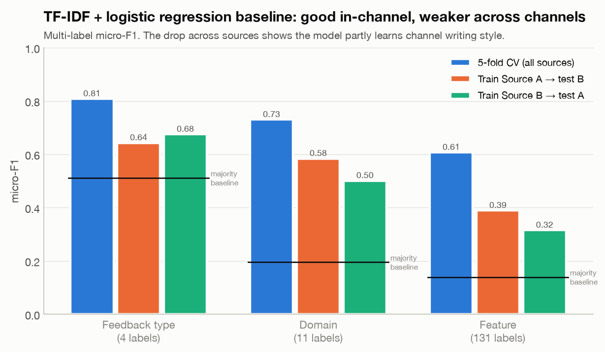

**Setup.**

- 8,903 de-duplicated labelled comments.
- TF-IDF on word 1–2-grams plus char 3–5-grams, feeding a one-vs-rest logistic regression with balanced class weights.
- Per-label F1: Likes 0.92, Difficult to Use 0.75, Defect 0.68, Wants 0.64. Domain F1 is weakest for Ownership & Service (0.48).
- The full metrics are in `reports/classifier_metrics.json`.

**How to read it.**

- In-channel performance is good enough to *route* comments: the right feature is in the top 3 87% of the time.
- The cross-source drop (0.81 → 0.64–0.68 for feedback type) shows the model partly learns *how a channel writes*, not only *what customers say*.
- Before trusting it on a new channel (dealer reports, app-store reviews, social media), fine-tune on a few hundred labelled examples from that channel.

### 6.2 Models worth training next, by task

| Task | Recommended model | Why | Effort |
|---|---|---|---|
| Feedback type / sentiment | Fine-tuned multilingual transformer (`xlm-roberta-base`, `deberta-v3-base`) with a multi-label head | Captures negation and contrast ("good, *but*…"); multilingual for JP/KR/EU sources | Medium (GPU hours) |
| Feature / domain routing | **Hierarchical** classifier: domain first, then feature within the domain. Alternatively a sentence-embedding + kNN (`all-mpnet-base-v2`, `multilingual-e5`) | 131+ long-tail labels; kNN adds new features without retraining | Low–medium |
| Feature + sentiment per aspect | **Aspect-based sentiment analysis (ABSA)**: span extraction of the aspect ("head-up display") + polarity per span (e.g. PyABSA, SetFit-ABSA, or a seq2seq model emitting `(aspect, polarity, reason)` triples) | Fixes the multi-aspect problem (11.9% of comments) at its root | Medium–high |
| Reason (L3) | Classifier conditioned on the predicted feature, or a zero-shot NLI model over the 21 reason families | Gives the "why" for new, unlabelled comments | Medium |
| Severity | Ordinal regression on Source C severity (very minor → very serious), then applied to other sources | Defects should be weighted by severity, not counted equally | Low |
| Few-shot / new features | **SetFit** (sentence-transformer + contrastive fine-tuning) with 8–16 examples per class | A new feature launches with no history | Low |
| Unlabelled pool / discovery | **BERTopic** (embeddings → UMAP → HDBSCAN → c-TF-IDF) on the 1,180 unlabelled comments and on each "Mixed" feature | Finds themes the VFC taxonomy does not have yet (e.g. "carrier lock-in" under Personal eSIM) | Low |
| Labelling at scale | **LLM-assisted labelling** (Claude) with the VFC taxonomy in the prompt, validated against the 8,948 human labels, plus **active learning** (label what the model is least sure about) | Cheaper than full manual annotation; measurable against existing labels | Medium |
| Verdict explanation | LLM summarisation over the *retrieved* quotes and the computed indices (retrieval-augmented, numbers come from `scoring.py`) | Fluent PM-ready rationale without hallucinated statistics | Low |
| Satisfaction driver analysis | Regress survey overall satisfaction on attribute scores (relative-weight / Shapley analysis) per model and market | Tells you which features *move* satisfaction, not just which get complaints | Low |
| Impact estimate | Complaint rate × sales volume per market (with the representativeness weights in `reports/market_representativeness.csv`) | Turns "bad" into "~N affected customers per year" | Low |

### 6.3 The target PM pipeline

```
 new feedback (text, model, market, channel)
        │
        ▼
 clean.py ── same rules as training (strip templates / advisor text / prompts, lowercase)
        │
        ▼
 aspect extraction ── today: top-k features from classifier.py
        │              next:  ABSA triples (aspect, polarity, reason) per clause
        ▼
 feature store ── append the labelled mention; keep channel, model, engine, market, date
        │
        ▼
 scoring.py ── channel-adjusted complaint / praise / request indices + intervals,
        │      shrunk to the domain prior (cold start)
        ▼
 verdict card ── Good / Leaning / Mixed / Bad + defect-vs-UX + top reasons
        │        + quotes + model/engine split + survey cross-check + option price
        ▼
 PM (CLI today → web dashboard / Slack digest / Jira ticket)
```

---

## 7. Survey, sales and option lists

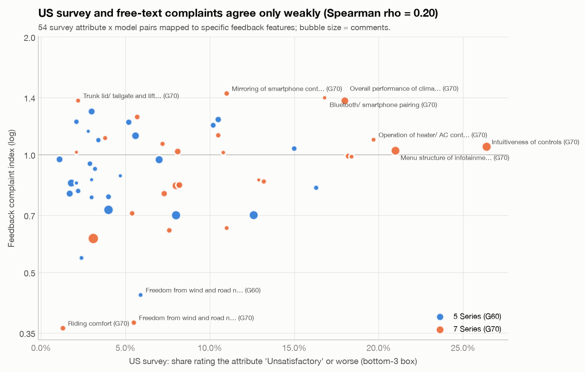

- **The US survey cross-check is weak.** 30 US survey attributes were mapped to specific feedback features by hand (`taxonomy.US_SURVEY_TO_FEATURES`). Across 54 attribute × model pairs with at least 10 comments, the survey's bottom-3-box and the feedback complaint index correlate with **Spearman rho = 0.20**.
  - Free text over-samples problems people call about, such as CarPlay and Bluetooth pairing.
  - The survey measures everyone, including silent satisfied owners.
  - Treat the two as complementary. Where they agree (G70 climate control, G70 "intuitiveness of controls" at 26% bottom-3), confidence is high.

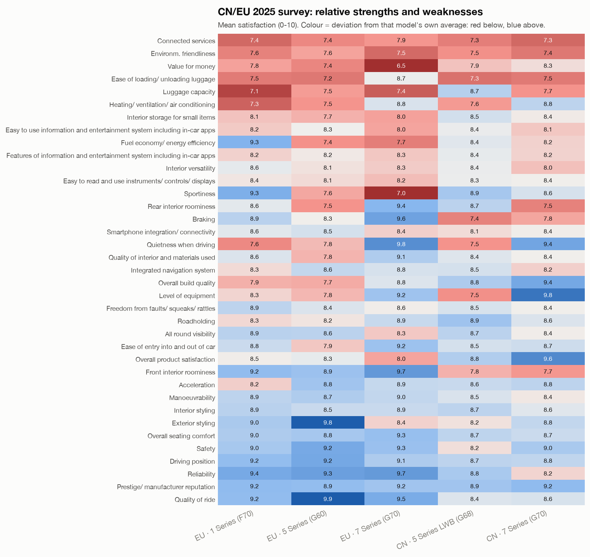

- **The CN/EU survey** covers markets the free-text data does not. Its weakest attributes:
  - "Connected services" (7.3–7.4) is among the three weakest attributes in 4 of the 5 model-market columns (all but EU G70). That is consistent with connected apps being a "Bad" domain in the feedback.
  - G70 EU "Value for money" is 6.5 and G70 EU "Sportiness" 7.0.
  - Luggage capacity and loading score low for the F70, G60 and G68.

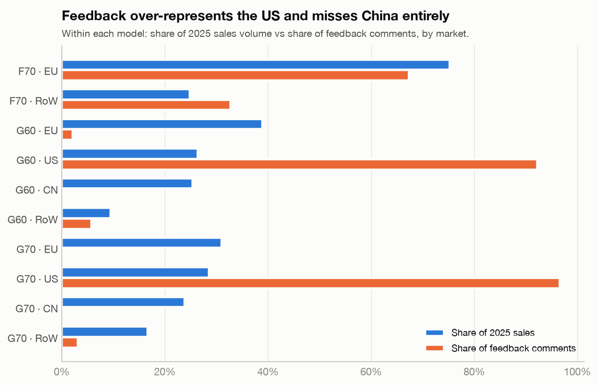

- **Sales vs feedback.**
  - The G60 EU accounts for 39% of 2025 G60/G68 volume but only 2% of G60 feedback. For the G70 EU it is 31% vs 0.4%.
  - China (≈25% of G60/G68 and G70 volume) has no free-text feedback at all.
  - **G60/G70 verdicts are effectively US verdicts.** Weight by sales (`reports/market_representativeness.csv`) only with care: the G70 EU weight would be ~85×, based on 13 comments.
- **Price lists.** `option_catalog.py` reads the three PDFs from glyph and text positions:
  - **Variant columns:** taken from the rotated column headers.
  - **Rows:** taken from the table rules.
  - **Marks:** each ■/□ mark is bound to the price line at its own height. A row can have several prices: 3G3 costs €1,520 on ICE variants and €300 on i5/PHEV.

  It yields 23 variants with base price and power, 364 items, 2,224 variant-level fitment cells, 97 package entries and 555 technical values.

  Each build checks:
  - every ■/□ mark is assigned to a variant column (1,889 of 1,889);
  - gross = net × 1.19 holds for 1,128 option prices and 23 base prices;
  - power matches between the price and technical pages for all 23 variants.

  One printed anomaly is kept as printed: F70 p.17, €2,280 gross against €1,915.67 net.

  Two coverage limits:
  - The G70 equipment tables cover only 4 of its 7 variants. Fitment for the others is reported as unknown.
  - All prices are German list prices. Nothing is projected to other markets.

  A curated keyword map links 106 feedback features to price-list items. Examples:
  - Head-up display: €3,800 on the F70 and €2,400 on the G60, in both cases via the Innovationspaket; standard on all covered G70 variants.
  - Panorama roof: €1,180 on the F70 and €1,630 on the G60; standard on the covered G70 variants.
  - Seat massage: G70 only, cheapest via the Connoisseur Paket (€3,200).

### 7.1 What the price lists changed in the models (`reports/model_ablation.json`)

| Model | Without price list | With price list | Verdict |
|---|---|---|---|
| Feature classifier, top-1 on 3,512 comments about linked features | 64.95% (text + car) | 65.58% | Small but significant: 26 fixed, 4 broken, McNemar p = 0.0001. Used when a comment is classified for a known car. |
| Complaint model (EBM), AUC, all 11,133 mentions, CV grouped by feature | 0.793 | 0.792 | No gain. The production model uses context only. |
| Same, 4,399 mentions of the 106 linked features | 0.639 | 0.633 | No gain. |

- **An apparent gain was a confound.** A first version without an umbrella-label control showed +0.033 AUC from the price-list inputs. Features without a price-list link are mostly umbrella labels that collect praise. Once `is_umbrella` was in the baseline, the gain disappeared.
- **Price sensitivity cannot be tested yet.** Only 74 labels give a value reason, all of them requests, and only 5 say "not standard / too costly".
- **The price lists therefore drive the deterministic layer.** The decision engine uses them for:
  - the price ladder across the three series;
  - the suggested move per series: fix standard equipment, fix a paid option, consider making an option standard, or introduce an item another series lists.

---

## 8. Other possibilities

- **Unmet-needs radar.** Rank features by request index:
  - Leading the list: Frunk (2.5), interior mirror, panorama roof (1.9), wheels/tyres (1.7), engine sound.
  - Cluster the request texts with BERTopic to get concrete feature ideas, for example "panorama roof that opens", "pet mode for climate", "multi-contour seat buttons".
- **Competitor mentions.** Comments compare with VW, Audi, Tesla and previous BMWs (e.g. "my old 740 had a sunglass holder"). A named-entity pass yields switching reasons and benchmark gaps.
- **Owner-education vs product-fix triage.** Many Source B "Difficult to Use" notes end with the advisor explaining the feature. A classifier for "solved by explanation" separates documentation and onboarding work from engineering work. Owner's Manual is one of the most requested items.
- **Root-cause linkage for defects.** Join defect mentions with warranty or workshop data (not provided) to estimate cost per complaint.
- **Severity-weighted defect index.** Use Source C severities to weight defects; "very serious" is ≈14% of Source C problems.
- **Release tracking.** With dates, compute the complaint index per software version (iDrive 8 → 8.5, OS 9) to verify that OTA fixes work.
- **Slack or e-mail digest.** A weekly job:
  1. Re-scores features.
  2. Posts features that moved from Mixed to Leaning bad.
  3. Attaches their verdict cards.
- **Interactive app.** Built: `python -m bmw_feedback serve` runs the Product Decision Studio (FastAPI + React) on top of `verdict.Context` and `decision.DecisionEngine`.

---

## 9. Caveats

- **No timestamps.** Every verdict is a single snapshot.
- **Market skew.** G60/G70 feedback is 92–97% US. F70 feedback is mostly GB and JP and comes from one channel (Source A). Cross-model comparisons are adjusted for channel but not for market.
- **Domain scores include umbrella praise** (Section 4.2). Compare components with the specific-only ranking.
- **Coarse verdict scale.** Verdicts are relative to comparable features: "Mixed" means "about as complained-about as a typical specific feature", not "fine". Thresholds are in `config.py` and should be tuned with PMs on ~20 features they know well.
- **Reason labels are noisy** (Section 3, item 1). Treat reason families as directional.
- **Price lists cover Germany only** and, for the G70, only 4 of 7 variants in the equipment tables. The feature-to-item links are curated keyword matches; each is shown with its keyword so it can be audited.
